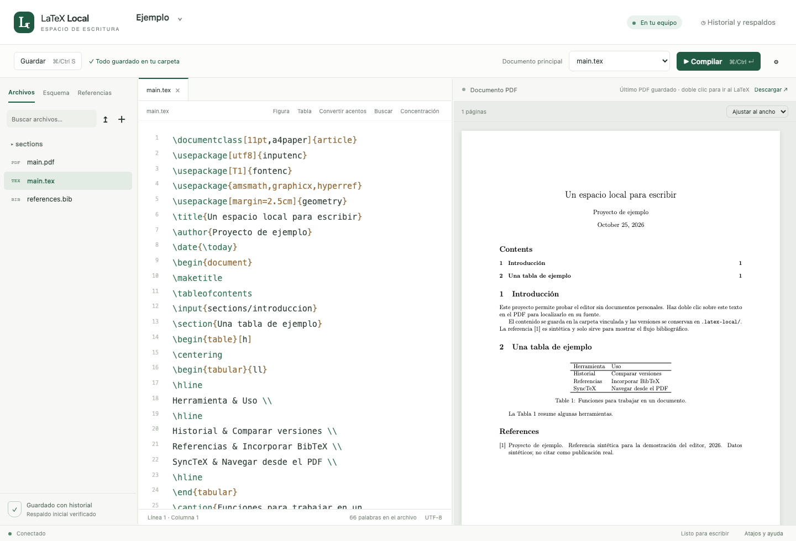
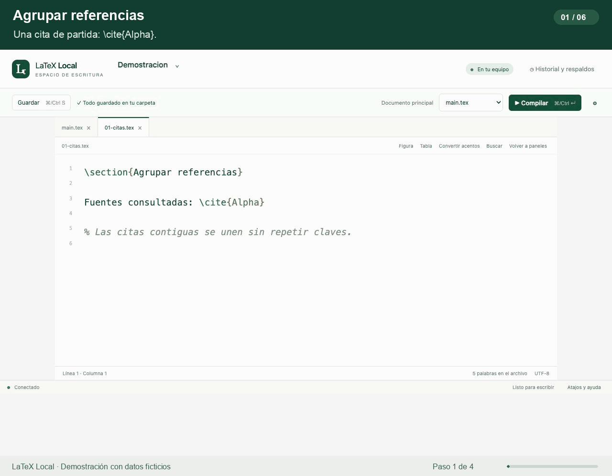

# LaTeX Local

Un editor LaTeX en tu navegador, con tus documentos en su carpeta original.

Pensado para tesis, artículos y documentos largos: código y PDF juntos, historial de versiones, respaldos y herramientas bibliográficas. La interfaz está en español y se sirve desde tu propio computador, sin CDN.



**Versión inicial: 0.1.0 · macOS y Linux · Python 3.10+ · licencia MIT**

## Qué incluye

- Editor con pestañas, autocompletado de citas y referencias, árbol de archivos y esquema del documento.
- Compilación mediante `latexmk`, con pdfLaTeX, XeLaTeX, LuaLaTeX y la ruta LaTeX/DVIPS. Compila el documento principal aunque estés editando un capítulo.
- PDF junto al código y navegación desde el PDF a la fuente con doble clic mediante SyncTeX.
- Guardado automático, recuperación de borradores en el navegador y detección de cambios externos.
- Historial con fecha, hora local y comparación de líneas agregadas y eliminadas. Restauración con respaldo del estado anterior.
- Versiones antes y después de las escrituras, instantáneas ZIP y exportación del proyecto.
- Búsqueda de DOI: primero en los `.bib` locales; opcionalmente, en Crossref y DataCite. Detecta duplicados y muestra el comando `\cite{clave}`.
- Incorporación de BibTeX y organización de entradas citadas y sin citar, con vista previa.
- Unión de N citas simples contiguas o anidadas, sin repetir claves.
- Indicador discreto de etiquetas `\label` sin referencias detectadas.
- Conversión de acentos al escribir en `.tex` y botón para convertir los existentes con vista previa.
- CLI y servidor MCP opcional para integraciones.

## Demostraciones animadas

[Ver las seis demostraciones](docs/funcionalidades.md): agrupar citas, detectar DOI duplicados, marcar etiquetas sin llamadas, comparar versiones y convertir tildes y ñ.



Las capturas muestran la aplicación funcionando con documentos ficticios. La galería también incluye imágenes estáticas.

## Instalación

Necesitas Python 3.10 o superior y una distribución TeX que incluya `latexmk`, BibTeX y SyncTeX. En macOS puedes usar MacTeX; en Linux, TeX Live con los paquetes que requiera tu documento. Windows nativo no está soportado: el almacenamiento utiliza `fcntl`.

Clona o descarga este repositorio y, dentro de su carpeta, ejecuta:

```bash
python3 -m venv .venv
source .venv/bin/activate
python -m pip install -r requirements.txt
./start.sh
```

Abre **http://127.0.0.1:8765**. Para detenerlo, pulsa `Ctrl+C` en la terminal. El lanzador utiliza `.venv/bin/python` automáticamente en los siguientes arranques.

### Probar con un ejemplo

En otra terminal, desde el repositorio:

```bash
./latex-cli new examples/minimal --name Ejemplo --main main.tex
./latex-cli compile Ejemplo
```

Recarga la página y abre `Ejemplo`. Este material es una demostración; no contiene tesis, artículos privados ni datos experimentales.

### Abrir tus documentos

Usa **Proyectos → Vincular una carpeta existente** e introduce la ruta completa de tu proyecto. También puedes hacerlo desde la terminal:

```bash
./latex-cli new /ruta/a/mi-documento --name MiDocumento --main main.tex
./latex-cli config MiDocumento
./latex-cli compile MiDocumento
```

Los cambios se guardan directamente en la carpeta vinculada. Puedes seleccionar el archivo principal y el motor desde la interfaz. Si una carpeta vinculada deja de estar disponible, el editor detiene las operaciones sobre ella.

## Historial y respaldos

Cada proyecto conserva su historial en **`.latex-local/` dentro de su propia carpeta**. Las escrituras pasan por un almacenamiento con comprobación de revisión, respaldo verificado y reemplazo atómico. Si el archivo cambió desde que se leyó, la API devuelve un conflicto y conserva el borrador para comparar.

Las instantáneas ZIP se generan al abrir la sesión, antes de compilar y periódicamente cada diez minutos para proyectos activos; se evitan instantáneas idénticas. También puedes solicitar un respaldo desde la interfaz. Los auxiliares de compilación van a `.latex-local/build/`; el último PDF compilado correctamente queda junto al archivo principal.

No borres ni edites manualmente `.latex-local/`. Los respaldos ocupan espacio y no tienen una política automática de purga. Al estar en el mismo disco, conviene complementar este historial con una copia externa de tus documentos.

## Referencias

Declara tu bibliografía en el documento, por ejemplo:

```tex
\bibliographystyle{plain}
\bibliography{references}
```

En **Incorporar referencias**, busca un DOI o pega una entrada BibTeX. Revisa los metadatos antes de incorporarlos. Si desmarcas la consulta externa, la búsqueda funciona solo con los archivos locales y el catálogo opcional. Cuando se consulta un servicio externo se envía el DOI, no el contenido del documento; el servicio también recibe los datos normales de conexión.

**Organizar bibliografía** permite colocar las entradas sin citar al final con una vista previa. La numeración final la determina el estilo bibliográfico: con IEEEtran sigue la primera aparición de las citas, no la posición física del `.bib`.

El catálogo inicial está vacío. Para compartir referencias entre proyectos, consulta [el formato del catálogo](docs/catalog.md). Los registros de las pruebas son sintéticos.

## Configuración opcional

| Variable | Uso | Predeterminado |
| --- | --- | --- |
| `LATEX_PYTHON` | Ejecutable Python; prevalece sobre `.venv` | `.venv/bin/python` o `python3` |
| `LATEX_PORT` | Puerto del lanzador | `8765` |
| `LATEX_PROJECTS_DIR` | Directorio del registro de proyectos | `projects/` en el repositorio |
| `LATEX_CONFIG_FILE` | Archivo de preferencias | `workspace.json` en el repositorio |
| `LATEX_REFERENCE_CATALOG` | Catálogo BibTeX opcional | Catálogo vacío incluido |

Las rutas de estas variables pueden ser absolutas o relativas al directorio de trabajo; usa rutas absolutas si alternas entre CLI y servidor. El lanzador web trabaja desde la raíz del repositorio. Las rutas vinculadas de los documentos se guardan como absolutas en el registro local.

```bash
LATEX_PORT=8766 ./start.sh
```

Puedes copiar `workspace.example.json` como `workspace.json` para elegir un proyecto predeterminado. El registro y las preferencias personales están excluidos de Git.

## Uso desde terminal e integraciones

```bash
./latex-cli --help
./latex-cli list
./latex-cli tree MiDocumento
./latex-cli read MiDocumento main.tex
```

La escritura por CLI reemplaza el archivo completo y conserva versiones. Lee primero el contenido; la API web exige además la revisión de origen para evitar sobrescrituras por concurrencia. El servidor MCP es opcional: [configuración](docs/mcp.md).

## Desarrollo y pruebas

Necesitas Node.js 18+ para las pruebas de los módulos del navegador y una instalación TeX con IEEEtran para las pruebas de integración.

```bash
source .venv/bin/activate
python -m pip install -r requirements-dev.txt
./scripts/test.sh
```

Las pruebas ejercitan respaldos, conflictos, restauración, referencias, compilación real, SyncTeX, citas, acentos y detección de etiquetas. Usan directorios temporales y un catálogo sintético. El workflow incluido ejecuta la suite en Ubuntu. Consulta [CONTRIBUTING.md](CONTRIBUTING.md).

## Alcance y publicación

Esta es una aplicación local para una persona, sin cuentas ni colaboración simultánea. El lanzador escucha en `127.0.0.1`; no está preparada para exponerse a Internet ni a una red compartida. El analizador de citas y etiquetas cubre comandos habituales y no sustituye la expansión completa de macros de TeX.

Este repositorio distribuye únicamente el editor, documentación, bibliotecas de interfaz y ejemplos. No incluye proyectos personales, registros, preferencias, respaldos ni bibliografías de investigación. Antes de publicar tu propia copia, revisa [la guía de publicación](docs/publishing.md).

## Licencia

[MIT](LICENSE), copyright 2026 LaTeX Local contributors. Las bibliotecas incluidas conservan sus [licencias originales](THIRD_PARTY_NOTICES.md).
