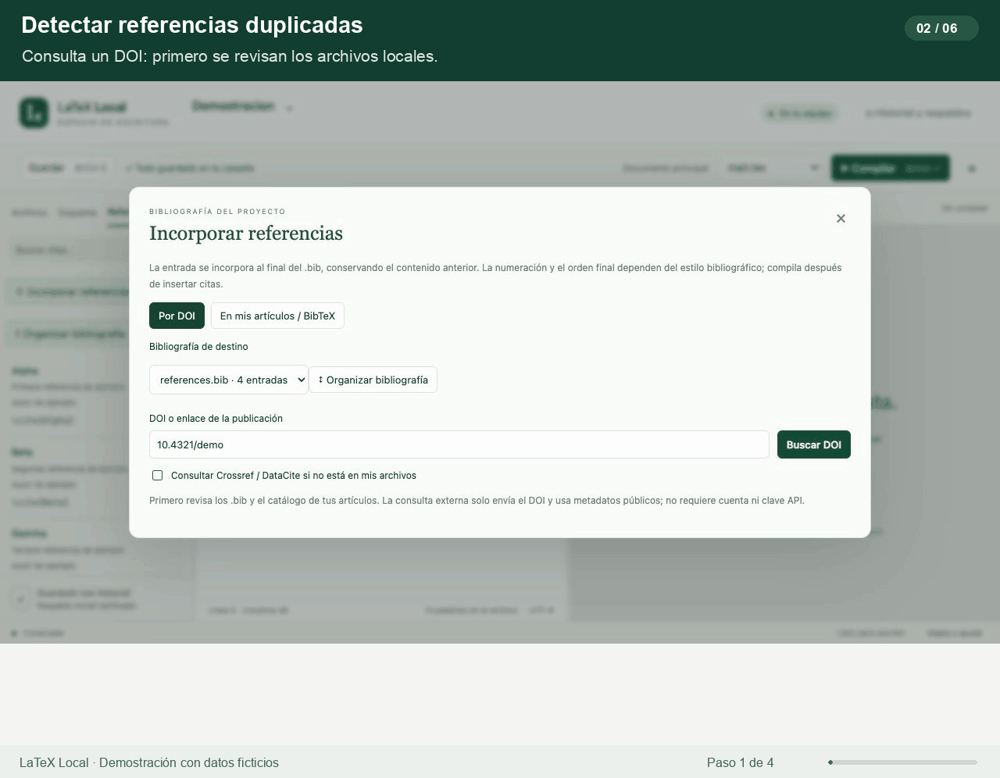
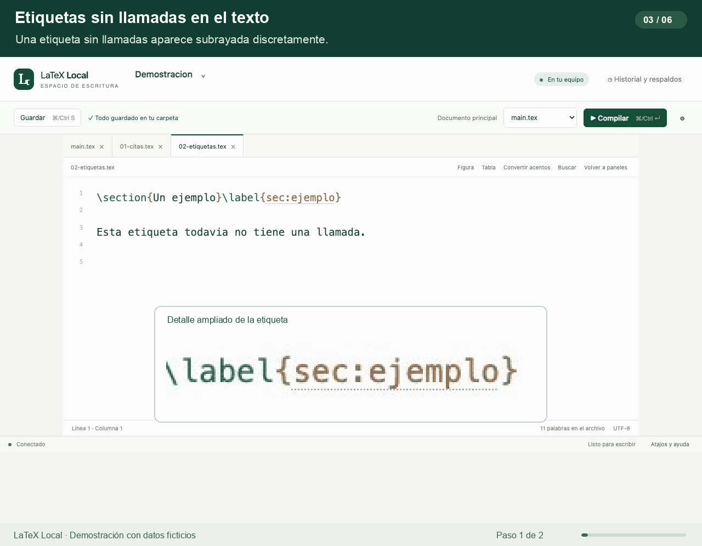
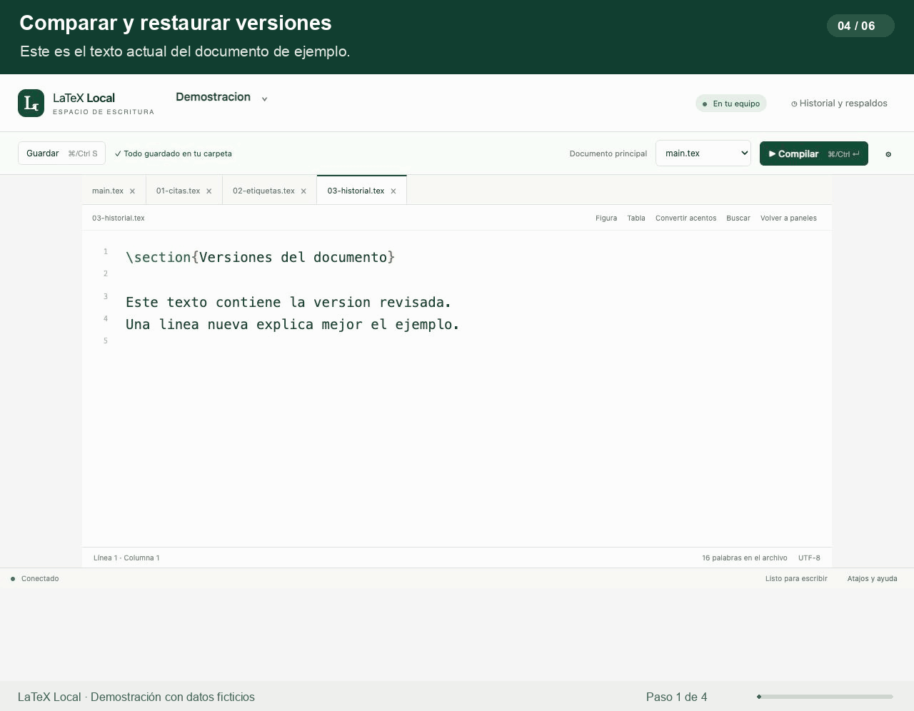
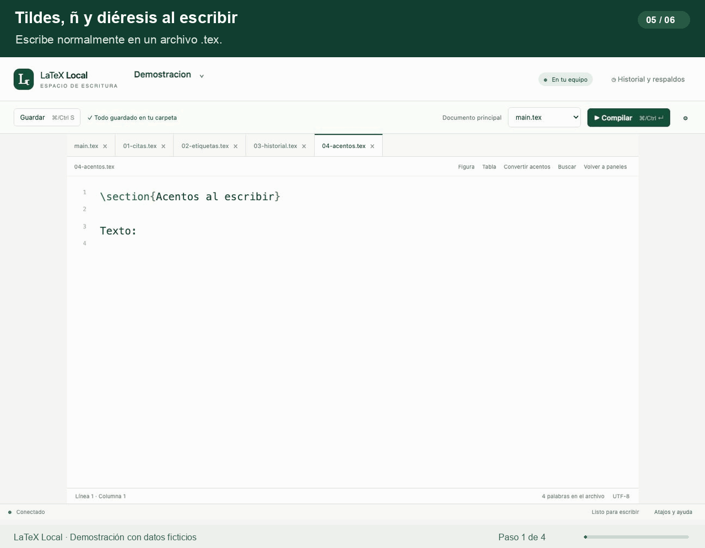
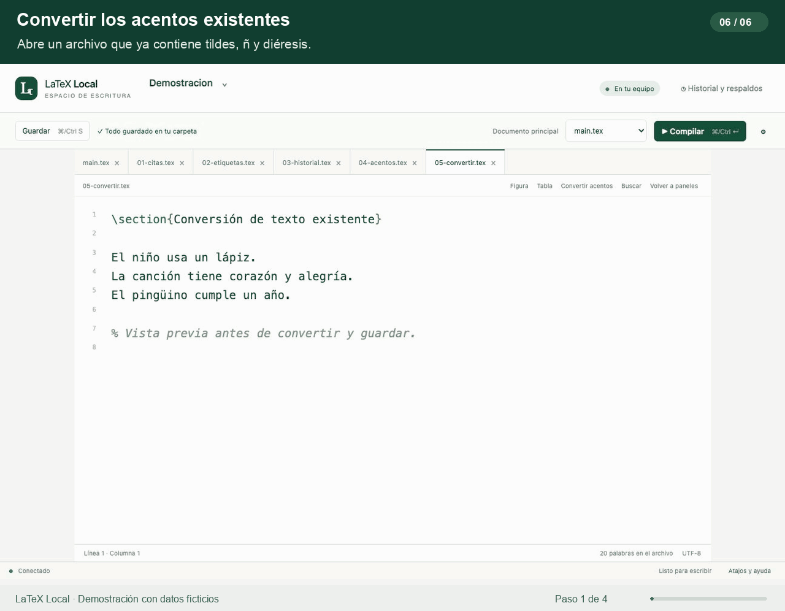

# Funcionalidades en movimiento

Seis demostraciones de la aplicación con documentos y referencias ficticios. Cada GIF se repite automáticamente; abre la imagen estática si prefieres leer sin animación. Las capturas proceden de una copia aislada del editor. Los rótulos y el detalle ampliado de una etiqueta se añadieron para facilitar la lectura.

## 1. Agrupar referencias

Al insertar o pegar comandos completos, las citas simples contiguas se unen en un único `\cite{Alpha,Beta,Gamma}`. Las claves repetidas se eliminan y las citas anidadas también se simplifican. La operación admite N citas.

[Imagen estática](animations/agrupar-citas.png)

## 2. Detectar referencias duplicadas

La consulta de un DOI que ya existe en el proyecto reconoce su entrada y ofrece reutilizar `\cite{Demo2026}`. La demostración mantiene las cuatro entradas del `.bib`, sin añadir una copia. Se grabó con la consulta externa desactivada y un DOI ficticio.

[Imagen estática](animations/referencias-duplicadas.png)

## 3. Marcar etiquetas sin llamadas en el texto

Un `\label{sec:ejemplo}` sin llamadas detectadas recibe un subrayado discreto. Al añadir `\ref{sec:ejemplo}`, el marcado desaparece. El recuadro amplía los píxeles originales de la etiqueta para mostrar el indicador.

[Imagen estática](animations/etiquetas-sin-referencia.png)

El análisis cubre los comandos habituales; no sustituye la expansión completa de macros de TeX.

## 4. Comparar y restaurar versiones

El historial muestra fecha y hora por archivo. La comparación resalta las líneas añadidas en verde y las eliminadas en rojo. Al restaurar una versión, se conserva también el estado que se reemplaza.

[Imagen estática](animations/historial-versiones.png)

## 5. Convertir tildes, ñ y diéresis al escribir

En los archivos `.tex`, escribir `lápiz`, `año` o `pingüino` produce automáticamente `l\'apiz`, `a\~no` y `ping\"uino`.

[Imagen estática](animations/acentos-y-ene.png)

## 6. Convertir los acentos de un archivo existente

El botón **Convertir acentos** permite revisar el antes y el después antes de aplicar los cambios. El guardado conserva un respaldo y la conversión puede deshacerse en el editor con un solo `Cmd+Z` o `Ctrl+Z`.

[Imagen estática](animations/convertir-acentos.png)

Los GIF duran entre 6 y 12 segundos y no tienen audio. [Manifiesto de archivos y duración](animations/manifest.json).

[Volver al README](../README.md)
